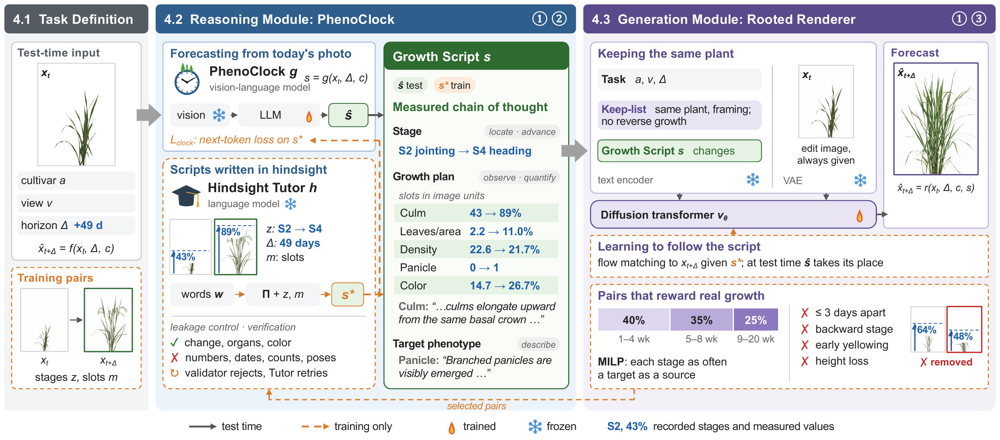
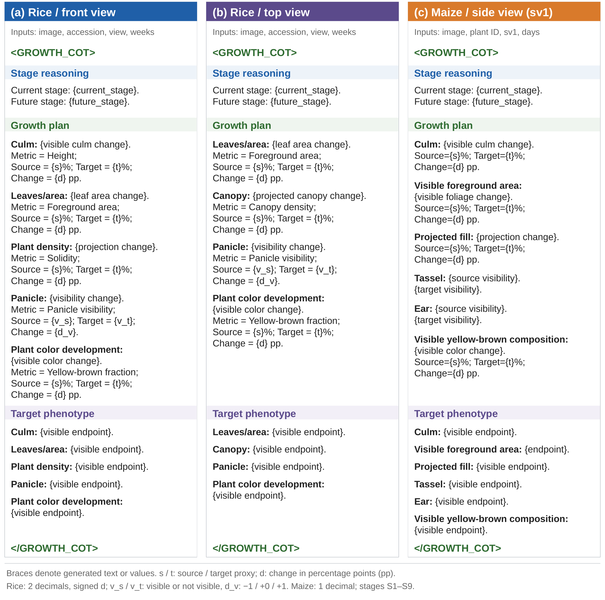

<div align="center">

<h1>AgroWM</h1>
<p>Built with Qwen</p>
<p><strong>Reason about development. Then render growth.</strong></p>
<p>Forecast the same plant over days to months from a single photograph.</p>
<p><strong>English</strong> · <a href="README_zh-CN.md">简体中文</a></p>
<p><a href="https://arxiv.org/abs/2611.26145">Paper (arXiv)</a> · <a href="https://github.com/ECNU-ICALK/ArgoWM">GitHub</a> · <a href="https://huggingface.co/ecnu-icalk/ArgoWM">Hugging Face</a></p>
<p><a href="#quick-start">Quick start</a> · <a href="docs/RESULTS.md">Results</a> · <a href="protocols/README.md">Prompts</a> · <a href="docs/RUNNING.md">Training &amp; evaluation</a></p>

</div>



*Original Figure 3 from the manuscript. The illustrated interval is 49 days; the rice prompt expresses it as 7 weeks. [Vector PDF](assets/method-overview.pdf).*

## Model summary

**AgroWM** is a two-stage framework for agricultural world modeling: predicting how the **same plant** will look at a requested future horizon. **PhenoClock** infers the current developmental stage, predicts the future stage, and writes a structured **Growth Script**. The **Rooted Renderer** edits the source photograph using that script while preserving the plant's identity, viewpoint, and framing.

The accompanying manuscript is titled **[“Can World Models Predict Rice Growth? Toward Agricultural World Models.”](https://arxiv.org/abs/2611.26145)** The mainline experiments cover rice and maize, with independently trained models for each crop.

> **Core idea:** the horizon alone does not determine a plant's future appearance. Forecast its developmental state before generating the image.

| Item | Specification |
|---|---|
| Task | Source-conditioned plant image forecasting |
| Reasoning module | PhenoClock: LoRA fine-tuning of [Qwen3.8-27B](https://huggingface.co/Qwen/Qwen3.8-27B) |
| Generation module | Rooted Renderer: full diffusion-transformer fine-tuning of [Qwen Image 2.1](https://huggingface.co/Qwen/Qwen-Image-2.1) |
| Intermediate representation | Stage reasoning → Growth plan → Target phenotype |
| Rice input | Source image, cultivar/accession, front/top view, rounded whole weeks |
| Maize input | Source image, plant ID, side view, exact interval in days |
| Test-time information | Source-only; true source/target stage annotations are not query inputs |
| Training | Crop-specific training from the original backbones; two epochs, global batch 16 |
| Image inference | 20 steps, BF16, frozen per-query seeds, native image geometry |
| Code / Planner adapter license | [Apache-2.0](LICENSE) |
| Renderer weight license | [Qwen Research License](LICENSES.md); non-commercial research/evaluation |

## Paired code and model releases

Release: **`agrowm-mainline-2026-11-24`**. This is the GitHub code release. The paired
Hugging Face model release contains the four final Ours parameter files and the
same implementation, protocols, settings and shared guides. Use [REPOSITORIES.md](docs/REPOSITORIES.md) to connect them;
[configs/model_release.json](configs/model_release.json) identifies the four
compatible components and their checksums.

## Repository contents

This repository provides the **mainline AgroWM implementation**, configuration recipes, prompt templates, schemas, examples, and tests. The paired Hugging Face model release supplies the final checkpoints for rice and maize; weight files are not included in this code repository. Each crop has a PhenoClock LoRA adapter and a trained Rooted Renderer diffusion transformer. See [CHECKPOINTS.md](docs/CHECKPOINTS.md) for the file layout, hashes, and loading instructions.

The published checkpoint set contains **Ours only**. Simple FT and other baseline weights, optimizer states, datasets, and the unmodified base-model files are not included. Obtain the base models separately; PhenoClock uses their tokenizer/processor and backbone, and the Renderer uses the base pipeline's frozen text encoder, VAE, and other supporting components.

AgroWM is a two-component pipeline used from a source checkout with an editable installation. Load the crop-specific components with the commands below. The repository root is not a single Transformers checkpoint, and there is no hosted inference endpoint.

```text
assets/                     Original paper Method figure and Growth Script figure
checkpoints/                Local model files after download/linking; ignored by Git
configs/recipes/            Rice and maize training/inference recipes
configs/local.example.json  Portable local-path configuration
examples/                   Synthetic Growth Script format examples
protocols/                  Mainline prompts and teacher schemas
scripts/                    Data preparation, training, inference, evaluation
src/wgsr_v9/                Implementation; stable internal namespace
docs/                       Installation, data, running guide, settings, results
tests/                      Data, training-math, inference and evaluation checks
requirements/               Separate CPU, Planner and Renderer dependencies
```

## Quick start

Use **Python 3.12**, Linux, and compatible NVIDIA GPUs for model inference. Keep Planner and Renderer environments separate; complete [INSTALL.md](docs/INSTALL.md) first. Obtain the matching model release and place or link its `checkpoints/` directory in this checkout as described in [REPOSITORIES.md](docs/REPOSITORIES.md). Obtain the two original base models separately.

### 1. Configure the released checkpoints

From the repository root, with the CPU preparation environment installed:

```bash
cp configs/released.example.json configs/local.released.json
# Edit base-model, data, environment, and output paths for your machine.
python scripts/configure.py \
  --settings configs/local.released.json --output configs/local-released
```

The example points to both the released PhenoClock adapters and the corresponding Rooted Renderer files. The generated configurations select the correct pair for each crop. [CHECKPOINTS.md](docs/CHECKPOINTS.md) describes both components and provides the integrity-check command.

### 2. Prepare the evaluation inputs

The existing benchmark workflow reads prepared manifests. Follow [DATA.md](docs/DATA.md) to import the frozen RGB images, pair metadata, seeds, and teacher supervision into the default layout:

```bash
python scripts/prepare_data.py \
  --crop rice --pairs /path/to/rice/pairs.jsonl --output data/rice --paper-split

python scripts/prepare_data.py \
  --crop maize --pairs /path/to/maize/pairs.jsonl --output data/maize --paper-split
```

Teacher and target information in the prepared package is kept out of the model's inference request. The current entry points operate on these manifests; they do not expose a separate raw single-photo convenience API.

### 3. Forecast with AgroWM

The commands below use the default `run_root=runs`. If you changed `run_root`,
replace the Planner `--output-dir` with `<your run_root>/$crop/planner_inference`
so it writes the script manifest at the path expected by the Renderer. Likewise,
use your configured `data_root` in the data-preparation commands above.

```bash
crop=rice  # or maize

.venv-planner/bin/python scripts/launch_planner_inference.py \
  --config "configs/local-released/$crop/planner_infer.json" \
  --output-dir "runs/$crop/planner_inference" \
  --batch-size 1 --gpu-groups '0,1'

.venv-renderer/bin/python scripts/run_executor_inference.py \
  --config "configs/local-released/$crop/executor_infer.json" \
  --variant predicted_cot
```

The GPU group must fit the Planner; see [RUNNING.md](docs/RUNNING.md) before changing topology. Invalid scripts are recorded explicitly and are never replaced with target-informed Tutor scripts. Evaluate the generated outputs using the same guide.

### Train from the base models

To reproduce training, start with `configs/local.example.json` and follow [RUNNING.md](docs/RUNNING.md). Rice and maize are trained independently. Simple FT requires a separately trained image model; its weights are not part of this release.

## Growth Script

The same three-section structure connects reasoning and generation. Fields and numeric formatting are crop- and view-specific.



- **Stage reasoning:** infer the current stage and forecast the future stage.
- **Growth plan:** describe developmental changes and quantify supported image proxies.
- **Target phenotype:** describe the expected appearance qualitatively.

Rice scripts use S1–S8, with named metrics for height, foreground area, projection density, panicle visibility, and yellow/brown composition as applicable to the view. Maize scripts use S1–S9, side-view proxies, tassel and ear descriptions. The actual annotated stages are not supplied as deployment inputs.

See the [exact prompt and schema map](protocols/README.md) and [format examples](examples/README.md). Numeric values are part of the script text; the Renderer has no separate numeric-injection adapter.

## Evaluation

The following values are **reported manuscript results**, not new measurements from this repository snapshot. Stage R@1 retrieves the target stage among the same plant/view's observed images; it is not the Planner's stage-classification accuracy. Area and Height are image-proxy errors in percentage points (lower is better); DINO and Stage R@1 are higher-is-better.

### Rice

| Method | DINO ↑ | Area ↓ | Height ↓ | Stage R@1 (%) ↑ |
|---|---:|---:|---:|---:|
| GPT Image 2 | 0.709 | 5.59 | 11.49 | 35.3 |
| GPT Image 2.5 | 0.721 | 6.92 | 12.57 | 34.8 |
| Qwen Image 2.1 | 0.693 | 7.85 | 18.28 | 24.0 |
| Qwen Image 2.1 FT / Simple | 0.834 | 3.73 | 7.83 | 47.4 |
| **AgroWM** | **0.860** | **3.51** | **7.43** | **54.6** |

At **9–20 weeks**, AgroWM reaches **46.4% Stage R@1**, compared with **35.7%** for Simple FT, a **10.7-point** gain.

### Maize

| Method | DINO ↑ | Area ↓ | Height ↓ | Stage R@1 (%) ↑ |
|---|---:|---:|---:|---:|
| Source copy | 0.522 | 3.62 | 33.02 | 0.0 |
| GPT Image 2 | 0.727 | 2.63 | 16.64 | 21.1 |
| Qwen Image 2.1 FT / Simple | 0.764 | 1.97 | 11.12 | 30.1 |
| **AgroWM** | **0.795** | **1.73** | **10.61** | **30.9** |

Maize models are trained independently; these results do not represent zero-shot transfer from rice. The Stage R@1 gain over Simple FT is **0.8 points** on maize, smaller than on rice.

See [RESULTS.md](docs/RESULTS.md) for denominators, settings and comparison boundaries, and [RUNNING.md](docs/RUNNING.md) for evaluation commands. Current zero-shot and script-conditioned base controls must be distinguished from historical paper runs with different input conditions.

## Training data and settings

| Property | Rice | Maize |
|---|---|---|
| Dataset family | WGSR / Open Plant Image Archive | WGSM / Open Plant Image Archive |
| Training queries | 20,000 | 6,400 |
| Validation queries | 2,000 | 1,600 |
| Held-out validation plants | 79 | 84 |
| Views | Front and top | Side (`sv1`) |
| Image size, width × height | 672×896 front; 896×672 top | 768×1280 |
| Forecast interval | `max(1, (actual_interval_days + 3) // 7)` weeks | Exact days |

The split is by plant. In rice, 78 of the 79 validation cultivars also occur in training. Teacher annotation is target-informed training supervision; inference uses predicted scripts from the source image alone. Image preparation and annotation precede the portable importer.

PhenoClock uses LoRA rank 32 / alpha 64 and grouped stage/metric/text loss weights **0.1 / 0.4 / 0.5**. The Rooted Renderer fine-tunes the diffusion transformer while keeping the text and VAE encoders frozen. Full settings are in [PROTOCOL.md](docs/PROTOCOL.md).

## Intended use and limitations

AgroWM supports research on developmental reasoning, source-conditioned crop image prediction, structured supervision, and phenotype-aware evaluation.

- Evidence is limited to the prepared rice and maize distributions, including white-background plant photographs. Field images, new crops and unseen cultivars require separate validation.
- The horizon describes elapsed time. Weather, treatment, soil and management records are not explicit model inputs.
- A forecast is a generated appearance, not an observed future. Traits are image-plane proxies rather than calibrated physical measurements or yield predictions.
- Growth-balanced pair selection, preprocessing and gallery construction affect the evaluation. A selected example is not a substitute for full validation.
- Errors in predicted stages and numeric targets can propagate to image generation. Tutor results use privileged future information and are a reference, not a deployable fallback.
- Exact historical comparisons require their original prompts, model versions, seeds and outputs. Closed API models may change.

## Documentation and license

| Resource | Purpose |
|---|---|
| [Released checkpoints](docs/CHECKPOINTS.md) | Component files, hashes and inference |
| [Installation](docs/INSTALL.md) | Environments, base models and hardware |
| [Data contract](docs/DATA.md) | Frozen pair manifests and supervision |
| [Mainline workflow](docs/RUNNING.md) | Training, inference and evaluation commands |
| [Experimental protocol](docs/PROTOCOL.md) | Training settings and metric definitions |
| [Reported results](docs/RESULTS.md) | Paper comparisons and interpretation |
| [Tests and development](docs/DEVELOPMENT.md) | Verification commands |
| [Third-party notices](THIRD_PARTY.md) | Upstream software and model terms |

**Code, documentation, and PhenoClock adapters:** Apache-2.0. **Rooted Renderer weights:** Qwen Research License, including its non-commercial research/evaluation restriction; commercial use requires a separate upstream license. See [LICENSES.md](LICENSES.md) for the component-specific terms and [NOTICE](NOTICE) for attribution. External software and datasets retain their respective licenses. Unmodified base-model weights and datasets are not redistributed here.
