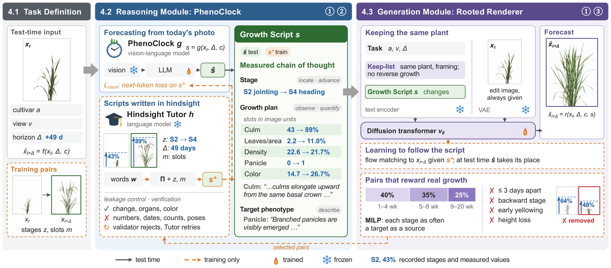

<div align="center">

# AgroWM

**Can World Models Predict Rice Growth? Toward Agricultural World Models**

[](https://arxiv.org/abs/2611.26145)
[](https://github.com/ECNU-ICALK/ArgoWM)
[](https://huggingface.co/ecnu-icalk/ArgoWM)

[English](README.md) · **简体中文**

Built with Qwen

</div>

**AgroWM** 从一张植物照片出发，预测同一株植物在数天至数月后的外观。它先推理植物的发育过程，再生成未来图像。我们在水稻和玉米上验证了这一方法。

> **先推理发育过程，再生成未来生长图像。**

## 方法

[](assets/method-overview.pdf)

*论文中的 Figure 3 原图，点击可查看矢量 PDF。*

- **PhenoClock** 推断当前生长阶段、预测未来阶段，并生成包含株高、面积、颜色和器官变化目标的 **Growth Script**。
- **Rooted Renderer** 按照脚本编辑源照片，在保留植株身份和视角的基础上生成未来外观。

PhenoClock 基于 **Qwen3.8-27B**，Rooted Renderer 基于 **Qwen Image 2.1**。中间脚本的具体格式见 [Growth Script 示例](examples/README.md)。

## 主要结果

以下为论文报告结果。Simple FT 使用同一图像基座进行微调，不使用 Growth Script。

| 作物 | 方法 | DINO ↑ | 面积误差 ↓ | 高度误差 ↓ | Stage R@1 (%) ↑ |
|---|---|---:|---:|---:|---:|
| 水稻 | Simple FT | 0.834 | 3.73 | 7.83 | 47.4 |
| 水稻 | **AgroWM** | **0.860** | **3.51** | **7.43** | **54.6** |
| 玉米 | Simple FT | 0.764 | 1.97 | 11.12 | 30.1 |
| 玉米 | **AgroWM** | **0.795** | **1.73** | **10.61** | **30.9** |

在水稻 **9–20 周**预测中，AgroWM 的 Stage R@1 为 **46.4%**，Simple FT 为 **35.7%**。水稻和玉米模型分别独立训练。

面积与高度为图像代理量误差，单位为百分点。Stage R@1 衡量预测图像是否能从同一株植物的真实图像序列中检索到目标阶段。[完整结果与评测说明](docs/RESULTS.md)。

## 快速开始

本仓库包含训练、推理与评测代码。配套的 [Hugging Face 仓库](https://huggingface.co/ecnu-icalk/ArgoWM)提供水稻和玉米的最终模型。

克隆代码；模型文件在 Hugging Face 发布后，可运行下面的下载命令：

```bash
git clone https://github.com/ECNU-ICALK/ArgoWM.git
cd ArgoWM

python -m pip install -U huggingface_hub
hf download ecnu-icalk/ArgoWM   --include 'checkpoints/**' --local-dir .
```

如果已下载完整的 Hugging Face 仓库，直接使用该目录即可。四份发布权重合计约 **30 GB**。

推理需要 **Linux、Python 3.12 和 NVIDIA GPU**：

1. [安装环境](docs/INSTALL.md)，准备两套所需的原始基座模型。
2. [准备数据](docs/DATA.md)，当前流程读取整理好的图像对 manifest。
3. 按照[模型加载与推理指南](docs/CHECKPOINTS.md#run-the-existing-benchmark-workflow)配置路径并运行 AgroWM。

从基座训练或评测预测结果，见[训练与评测指南](docs/RUNNING.md)。本次权重仅包含 **AgroWM**；原始基座、数据集和基线权重需另行准备。

## 文档

| 文档 | 内容 |
|---|---|
| [模型与推理](docs/CHECKPOINTS.md) | 模型组件、加载方式、推理命令和适用范围 |
| [训练与评测](docs/RUNNING.md) | 水稻和玉米的主线实验流程 |
| [Prompt](protocols/README.md) · [Growth Script](examples/README.md) | 提示词模板与脚本格式 |
| [实验设置](docs/PROTOCOL.md) | 训练配置与指标定义 |
| [代码与模型对应](docs/REPOSITORIES.md) | 配套版本、下载与校验 |

现有实验使用白背景水稻和玉米图像，田间场景与其他作物仍需进一步验证。问题和错误报告可提交到 [GitHub Issues](https://github.com/ECNU-ICALK/ArgoWM/issues)。

## 引用

如果本项目对你的研究有帮助，请引用我们的[论文](https://arxiv.org/abs/2611.26145)：

```bibtex
@misc{ji2026agrowm,
  title         = {Can World Models Predict Rice Growth? Toward Agricultural World Models},
  author        = {Wenkai Ji and Zeteng Li and Yinkun Guo and Jie Zhou and Liang He and Zhenong Jin},
  year          = {2026},
  eprint        = {2611.26145},
  archivePrefix = {arXiv},
  url           = {https://arxiv.org/abs/2611.26145}
}
```

## 许可证

代码、文档和 PhenoClock adapter 使用 **[Apache-2.0](LICENSE)**。Rooted Renderer 权重遵循 **[Qwen Research License](LICENSES.md)**，限非商业研究和评估。各组件的具体条款见 [LICENSES.md](LICENSES.md)，署名见 [NOTICE](NOTICE)。
