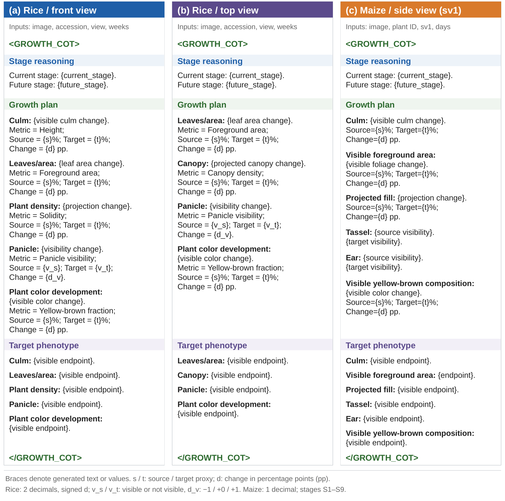

# Growth Script format examples

These **synthetic** text examples illustrate accepted output structure. They are
not measured plants, model predictions, biological validation examples or input
datasets for the published experiments.

| Example | View | Numeric format |
|---|---|---|
| [Rice front](rice_front_growth_script.txt) | Front | Named metrics, two decimals, signed changes |
| [Rice top](rice_top_growth_script.txt) | Top | View-specific canopy fields; no height slot |
| [Maize](maize_growth_script.txt) | Side (`sv1`) | One decimal; crop-specific organ text |

Each script contains `Stage reasoning`, `Growth plan`, and `Target phenotype`
inside one `<GROWTH_COT>` block. The numbers belong to the script text and are
not an additional tensor input to the Renderer. A syntactically valid example
need not be a biologically plausible forecast.

For real inputs, use the [portable pair schema](../docs/DATA.md). For the precise
system prompts, stage scales and teacher annotation schemas, see
[protocols/README.md](../protocols/README.md). Prepared Planner inference excludes
the supervised assistant message and real target information.
